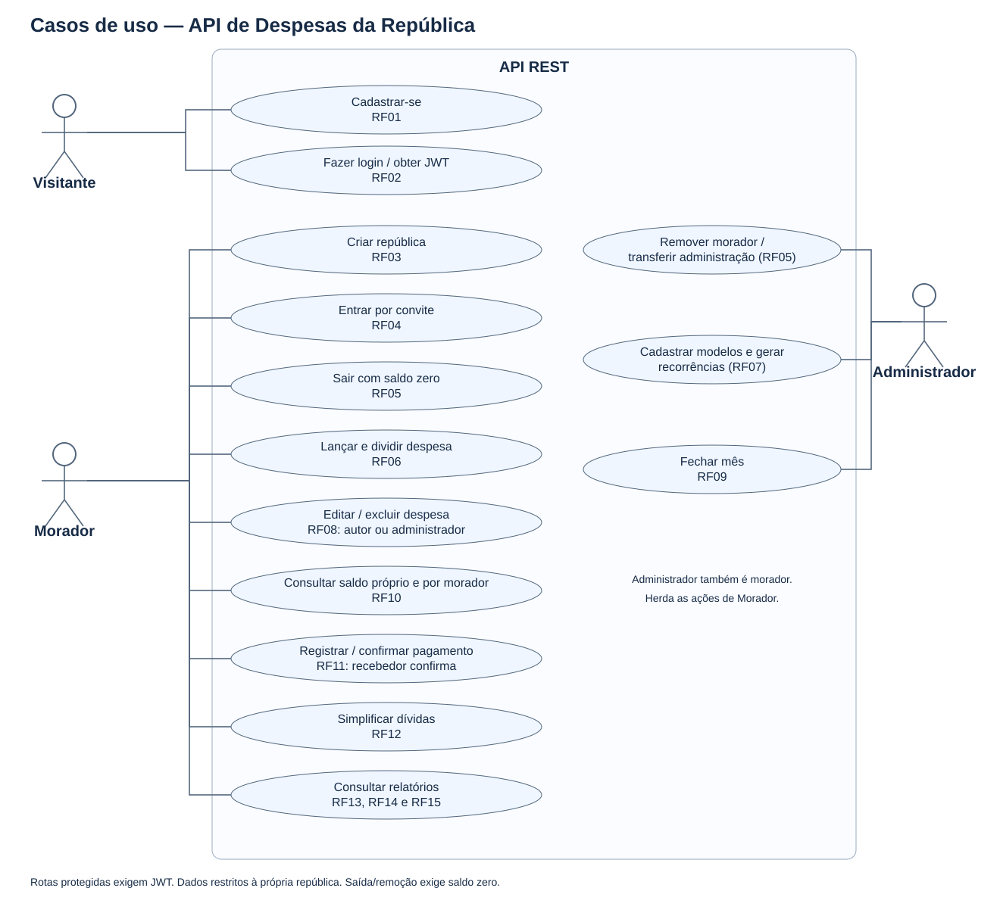
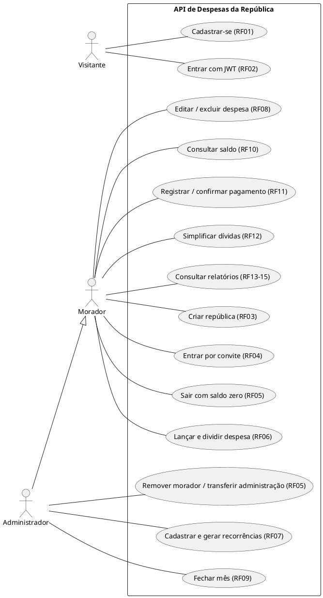
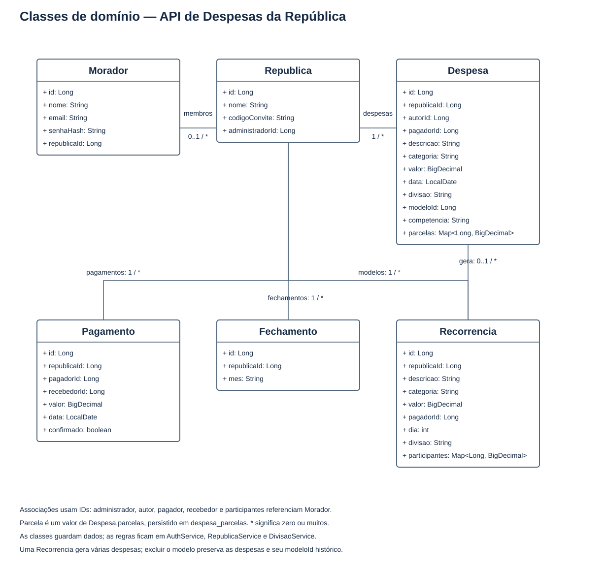
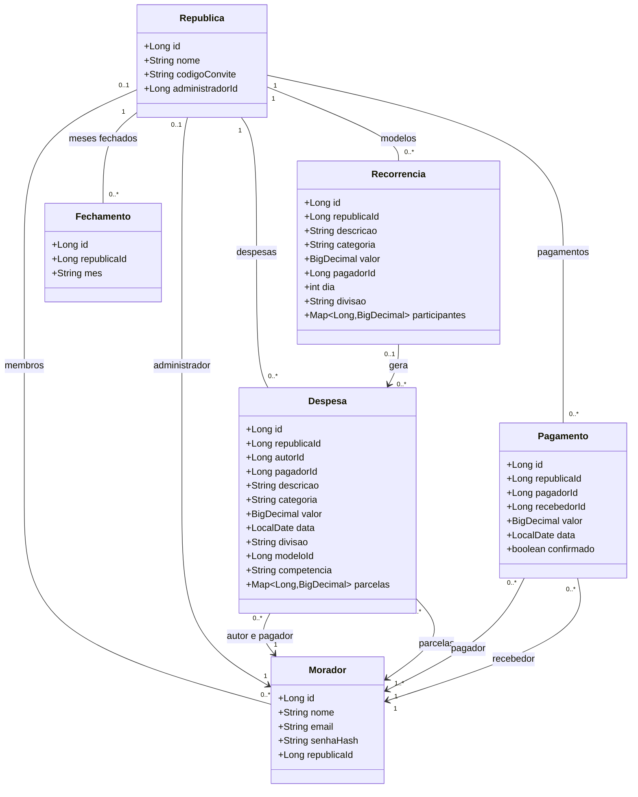

# Diagramas do projeto

As imagens SVG podem ser abertas no navegador. As associações do diagrama de classes representam os IDs usados no código, e não relacionamentos JPA com `@ManyToOne`. Parcela é um valor no mapa de `Despesa`, não uma entidade separada.

## Casos de uso

Administrador também é morador e pode executar seus casos de uso. Editar/excluir despesa exige ser autor ou administrador. Sair/remover exige saldo zero. Confirmar pagamento exige ser o recebedor. Todos os dados ficam restritos à própria república.

Fonte PlantUML editável:

## Classes de domínio

Fonte Mermaid editável (renderizada no GitHub):

Os modelos não possuem métodos de negócio; as regras ficam nos serviços. Um modelo recorrente excluído pode ter seu ID mantido no histórico da despesa gerada.
